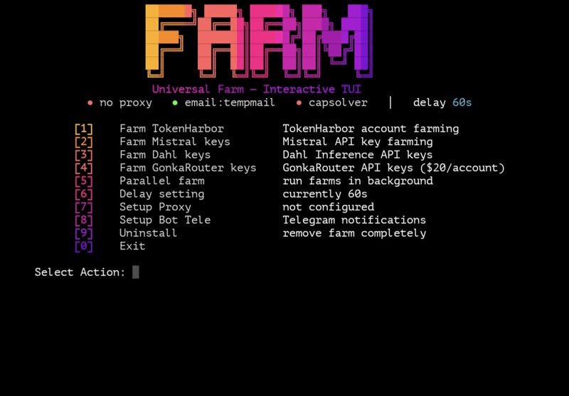
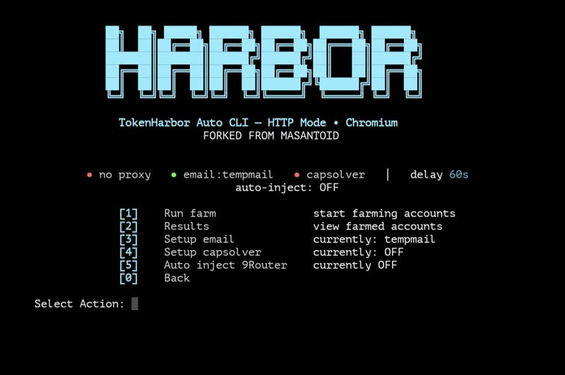
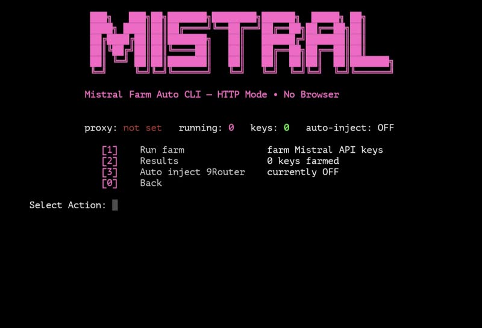
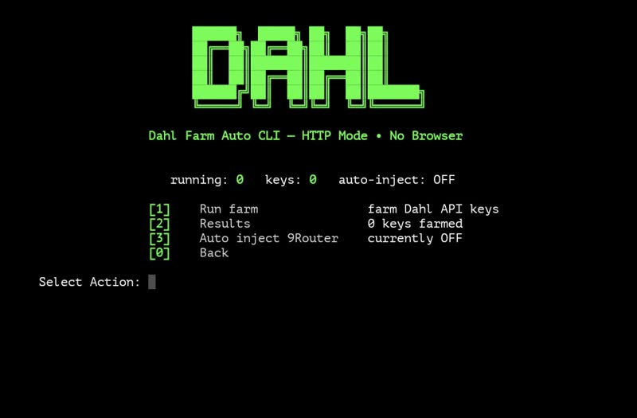
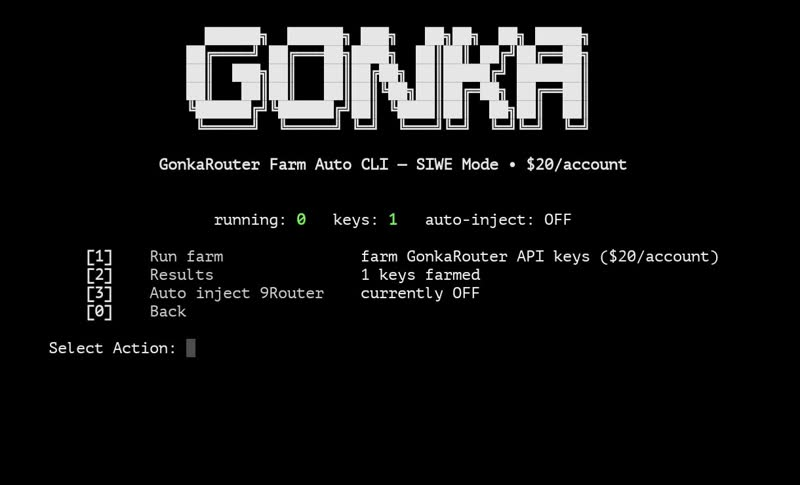

<div align="center">

# Universal Farm

[](https://opensource.org/licenses/MIT)
[](https://www.python.org/downloads/)
[]()

Farming API key dari 4 provider AI via cli terminal. Key otomatis masuk 9Router, laporan dikirim ke Telegram.



**Daftar Isi**

1. [Kenapa ada tool ini](#kenapa-ada-tool-ini)
2. [Provider](#provider)
3. [Mulai cepat](#mulai-cepat)
4. [Fitur](#fitur)
5. [Screenshot](#screenshot)
6. [Instalasi manual](#instalasi-manual)
7. [Menu](#menu)
8. [Setting](#setting)
9. [Cara kerja inject 9Router](#cara-kerja-inject-9router)
10. [File hasil](#file-hasil)
11. [Di Termux](#di-termux)
12. [Kalau ada masalah](#kalau-ada-masalah)
13. [Dibangun dengan](#dibangun-dengan)
14. [Lisensi](#lisensi)

</div>

## Kenapa ada tool ini

API key gratis dari provider AI itu kepake banget buat coding, tapi bikin akun satu satu itu capek. Tool ini otomatisin semuanya: bikin akun, ambil key, masukin ke 9Router, kirim laporan ke Telegram. Tinggal pilih menu, tunggu, beres.

## Provider

| Provider | Work Flow | From Farm |
|---|---|---|
| TokenHarbor | Browser Chromium | Akses model gratis |
| Mistral AI | Pure HTTP | Free From Mistral |
| Dahl Inference | Pure HTTP | 100 juta token |
| GonkaRouter | Pure HTTP | USD 20 |

## Auto install

```bash
curl -fsSL https://raw.githubusercontent.com/zal-m10/universal-farm/main/install.sh | bash
```

Abis itu ketik `farm`, pilih provider, masukin jumlah farm, lets farm.

## Features

| Features| Informations |
|---|---|
| Menu interaktif | Tinggal pilih nomor di terminal |
| Auto inject 9Router | Key otomatis masuk 9router |
| Notifikasi Telegram | Ringkasan + daftar key tiap farm selesai |
| Progres batch | Tiap 30 key baru langsung dikirim ke Telegram |
| Rotasi proxy | Ganti tiap akun, format `user:pass@host:port` |
| Email use | Tempik or Temp Mail |
| Capsolver opsional | ON/OF mode |
| Parallel farm | Farm multi providers |
| Background farm | Farming nya nggak usah di tungguin |

## Screenshot






## Instalasi manual

```bash
git clone https://github.com/zal-m10/universal-farm.git
cd universal-farm
python3 -m venv .venv
.venv/bin/pip install playwright requests rich eth-account
.venv/bin/python -m playwright install chromium
```

Di Debian/Ubuntu, install juga dependency OS buat Chromium:

```bash
.venv/bin/python -m playwright install-deps chromium
```

Jalankan:

```bash
.venv/bin/python -m tools.tokenharbor.farm_tui
```

## Uninstall

```bash
curl -fsSL https://raw.githubusercontent.com/zal-m10/universal-farm/main/uninstall.sh | bash
```

Atau dari dalam aplikasi: menu `[9] Uninstall`. Ini bakal hapus `~/universal-farm`, perintah `farm`, semua hasil farm, dan log sementara. 9Router tidak ikut kehapus.

## Menu

| No | Menu | Buat apa |
|---|---|---|
| 1 | Farm TokenHarbor | Bikin akun TokenHarbor pakai browser |
| 2 | Farm Mistral keys | Bikin API key Mistral pakai HTTP |
| 3 | Farm Dahl keys | Bikin API key Dahl pakai HTTP |
| 4 | Farm GonkaRouter keys | Bikin API key GonkaRouter pakai wallet |
| 5 | Parallel farm | Jalanin beberapa farm di background |
| 6 | Delay setting | Jeda antar akun, dalam detik |
| 7 | Setup Proxy | Atur daftar proxy |
| 8 | Setup Bot Tele | Isi token bot dan chat ID Telegram |
| 9 | Uninstall | Hapus semua sampai bersih |
| 0 | Exit | Keluar |

Tiap submenu farm isinya: Run farm (foreground atau background), Results (lihat/salin/hapus key), sama Auto inject 9Router (ON/OFF).

## Setting

### Proxy

Satu proxy per baris di `tools/proxies.txt`:

```
user:pass@host:port
```

Tanda `@` sebelum host itu wajib. Kalau nulisnya `user:pass:host:port` (pakai titik dua), koneksi proxy bakal gagal. File ini tidak ikut ke repo karena isinya kredensial.

### Email sekali pakai (TokenHarbor)

Ada di submenu TokenHarbor. Dua pilihan:

1. Tempik: pakai instansi Tempik sendiri. Tinggal masukin base URL-nya, misal `https://tempik.domainlo.com`.
2. Temp Mail: pakai tempmail.lol, langsung jalan tanpa setting. Tapi kadang email verifikasinya tidak masuk. Kalau begitu, pakai Tempik saja.

### Capsolver (TokenHarbor)

Opsional. Ada saklar ON/OFF. Tanpa capsolver pun tidak masalah karena signup pakai browser Chromium beneran, jadi Turnstile keverifikasi otomatis. Key-nya disimpan di `tools/.capsolver_key`, tidak ikut ke repo.

### Bot Telegram

Isi Bot Token (bikin di BotFather) dan Chat ID di menu `[8]`. Tiap farm selesai bakal kirim ringkasan + daftar API key ke Telegram. Kalau batch gede, progres dikirim tiap ada 30 key baru.

## Cara kerja inject 9Router

Kalau dinyalain, key hasil farm otomatis masuk ke SQLite 9Router di `/var/lib/9router/db/data.sqlite`:

1. Node dicari pakai baseUrl, bukan nama. Jadi kalau node sudah ada, dipakai ulang, tidak bikin baru.
2. Prefix bawaan: `HrbrFarm` (TokenHarbor), `mstrlfarm` (Mistral), `DahlFarm` (Dahl), `gofarm` (GonkaRouter).
3. Key yang sudah ada dilewati. Dijalanin berkali-kali pun aman.

## File hasil

| Provider | Lokasi |
|---|---|
| TokenHarbor | `account.json` di folder repo |
| Mistral | `/root/mistral_keys.txt` |
| Dahl | `/root/dahl_keys.txt` |
| GonkaRouter | `/root/gonka_keys.txt` |

File kredensial dan proxy tidak diikutkan ke repo.

## Di Termux (Android)

```bash
pkg update -y && pkg install -y python git curl
git clone https://github.com/zal-m10/universal-farm
cd universal-farm
python -m venv .venv
.venv/bin/pip install requests rich
```

Chromium tidak jalan di Android, jadi Farm TokenHarbor yang butuh browser tidak bisa dipakai di Termux. Pakai VPS buat itu. Farm Mistral, Dahl, dan GonkaRouter yang murni HTTP jalan normal di Termux.

## Kalau ada masalah

**`farm: command not found`.** Installer naruhnya di `~/.local/bin`. Tambahin ke PATH:

```bash
export PATH="$HOME/.local/bin:$PATH"
```

**`ERR_PROXY_CONNECTION_FAILED`.** Cek format proxy, harus `user:pass@host:port` pakai `@`.

**Muncul "You're doing that a bit fast".** Ini limit dari server TokenHarbor, bukan dari IP atau email. Berhenti dulu beberapa jam, terus coba 1 akun aja dengan jeda panjang.

**Email verifikasi tidak masuk (Temp Mail).** Ganti ke Tempik.

**GonkaRouter sering 401 habis timeout.** Nonce SIWE cuma sekali pakai. Versi terbaru sudah ambil nonce baru tiap retry. Update pakai `git pull`.

## Dibangun dengan

[]()
[]()
[]()
[]()

## Lisensi

MIT. Fork dari [hirotomasato/harbor](https://github.com/hirotomasato/harbor).
